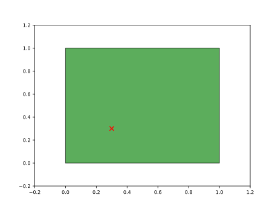
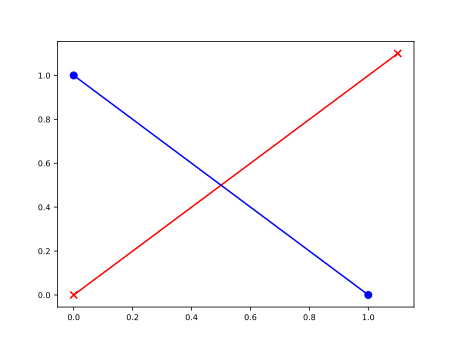
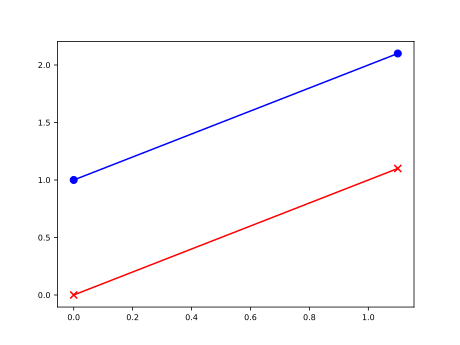
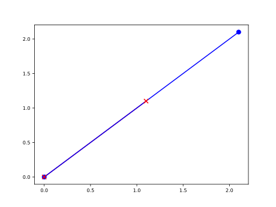
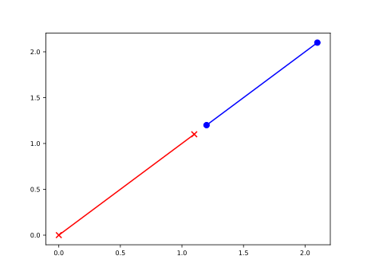
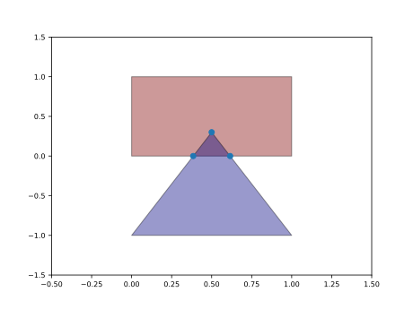
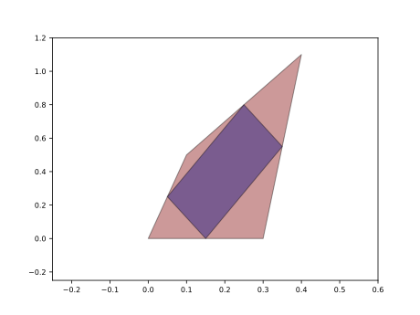
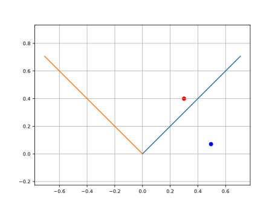
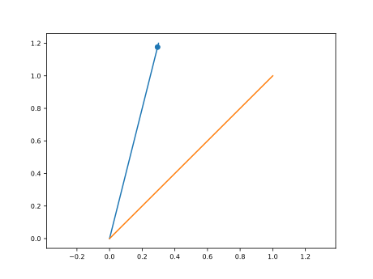

[](https://github.com/mikecokina/pypex/tree/master)
[](https://opensource.org/license/mit)
[](https://www.python.org/)
[](https://en.wikipedia.org/wiki/Operating_system)

# Pypex

**Pypex** is python library created for purpose of easier interactions with 2D convex polygons and lines.
It gives you a strong and simple tool if you need determine properties such as surface areas of polygons
defined by points, find if two lopygons intersects each other or determine polygon in which other two defined
polygons intersects.

## Python compatibility

Verified with Pypex **0.3.0dev0** on Linux in fresh virtual environments.
Each environment passed the full test suite, package installation and `pip check`.

| Python      | NumPy | Matplotlib | Unit tests  | Dependency check |
|:------------|:------|:-----------|:-----------:|:----------------:|
| **3.11.15** | 2.4.6 | 3.11.2     | ✅ 118 / 118 |     ✅ Passed     |
| **3.12.3**  | 2.5.4 | 3.11.2     | ✅ 118 / 118 |     ✅ Passed     |
| **3.13.14** | 2.5.4 | 3.11.2     | ✅ 118 / 118 |     ✅ Passed     |
| **3.14.6**  | 2.5.4 | 3.11.2     | ✅ 118 / 118 |     ✅ Passed     |

These are verified dependency combinations; minimum supported versions are
specified in `setup.py`.

## Examples

In this sections are shown several examples of `pypex` usage.

### Point vs Polygon interaction

**[In]**

```python
from pypex import Polygon, Point

point = Point(0.3, 0.3)
polygon = Polygon([[0.0, 0.0], [1.0, 0.0], [0.0, 1.0], [1.0, 1.0]])
# You can also use .contains_point() in case of Polygon instance.
in_poly = point.is_inside_polygon(polygon)
print(f"{point} is inside polygon: {in_poly}")
```

**[Out]**

```text
Point [0.3, 0.3] is inside polygon: True
```

<p align="center"></p>

### Point properties

**[In]**

```python
from pypex import Polygon, Point

point = Point(0.3, 0.3)
pnt_array = point.to_array()
print(f"Point as numpy array {pnt_array}")
```

**[Out]**

```text
Point as numpy array [0.3 0.3]
```

**[In]**

```python
pnt_list = point.to_list()
print(f"Point as python list {pnt_list}")
```

**[Out]**

```text
Point as python list [0.3, 0.3]
```

**[In]**

```python
points = [Point(0.3456111, 0.3123), Point(0.3456, 0.3123)]
set_tol3 = Point.set(points, round_tol=3)
print(f"Points {points} define following set with tolerance 3: {set_tol3}")
```

**[Out]**

```text
Points [Point [0.3456111, 0.3123], Point [0.3456, 0.3123]] define following set with tolerance 3: [Point [0.3456111, 0.3123]]
```

**[In]**

```python
set_tol9 = Point.set(points, round_tol=9)
print(f"Points {points} define following set with tolerance 9: {set_tol9}")
```

**[Out]**

```text
Points [Point [0.3456111, 0.3123], Point [0.3456, 0.3123]] define following set with tolerance 9: [Point [0.3456111, 0.3123] Point [0.3456, 0.3123]]
```

### Line vs Line interaction

In the full intersection output, `full[3]` is the perpendicular distance between
the infinite lines when they are parallel (`0.0` for collinear lines), and `nan`
otherwise. It is not the minimum distance between the finite segments.

**[In]**

```python
from pypex import Line

line1 = Line([[0.0, 0.0], [1.1, 1.1]])
line2 = Line([[0.0, 1.0], [1.0, 0.0]])

intersects = line1.intersects(line2)
print(f"{line1} is in intersection with {line2}: {intersects}")
```

**[Out]**

```text
Line: [[0. 0.], [1.1 1.1]] is in intersection with Line: [[0. 1.], [1. 0.]]: True
```

**[In]**

```python
intersection = line1.intersection(line2)
print(f"{line1} intersects {line2} in {intersection}")
```

**[Out]**

```text
Line: [[0. 0.], [1.1 1.1]] intersects Line: [[0. 1.], [1. 0.]] in Point [0.5, 0.5]
```

**[In]**

```python
# full output
full = line1.intersects(line2, _full=True)
print("full info of intersection of {} and {}\n"
      "     defined infinite lines intersects: {}\n"
      "     defined segments intersects: {}\n"
      "     defined segments intersects in {}\n"
      "     defined infinite lines distance {}\n"
      "     defined segments description {}\n"
      "".format(line1, line2, full[0], full[1], full[2], full[3], full[4]))
```

**[Out]**

```text
full info of intersection of Line: [[0. 0.], [1.1 1.1]] and Line: [[0. 1.], [1. 0.]]
    defined infinite lines intersects: True
    defined segments intersects: True
    defined segments intersects in Point [0.5, 0.5]
    defined infinite lines distance nan
    defined segments description INTERSECT
```

<p align="center"></p>

**[In]**

```python
line1 = Line([[0.0, 0.0], [1.1, 1.1]])
line2 = Line([[0.0, 1.0], [1.1, 2.1]])
full = line1.intersects(line2, _full=True)
print("full info of intersection of {} and {}\n"
      "     defined infinite lines intersects: {}\n"
      "     defined segments intersects: {}\n"
      "     defined segments intersects in {}\n"
      "     defined infinite lines distance {}\n"
      "     defined segments description {}\n"
      "".format(line1, line2, full[0], full[1], full[2], full[3], full[4]))
```

**[Out]**

```text
full info of intersection of Line: [[0. 0.], [1.1 1.1]] and Line: [[0. 1.], [1.1 2.1]]
    defined infinite lines intersects: False
    defined segments intersects: False
    defined segments intersects in nan
    defined infinite lines distance 0.7071067811865476
    defined segments description PARALLEL
```

<p align="center"></p>

**[In]**

```python
line1 = Line([[0.0, 0.0], [1.1, 1.1]])
line2 = Line([[0.0, 0.0], [2.1, 2.1]])
full = line1.intersects(line2, _full=True)
print("full info of intersection of {} and {}\n"
      "     defined infinite lines intersects: {}\n"
      "     defined segments intersects: {}\n"
      "     defined segments intersects in {}\n"
      "     defined infinite lines distance {}\n"
      "     defined segments description {}\n"
      "".format(line1, line2, full[0], full[1], full[2], full[3], full[4]))
```

**[Out]**

```text
full info of intersection of Line: [[0. 0.], [1.1 1.1]] and Line: [[0. 0.], [2.1 2.1]]
    defined infinite lines intersects: True
    defined segments intersects: True
    defined segments intersects in nan
    defined infinite lines distance 0.0
    defined segments description COLINEAR
```

<p align="center"></p>

**[In]**

```python
line1 = Line([[0.0, 0.0], [1.1, 1.1]])
line2 = Line([[1.2, 1.2], [2.1, 2.1]])
full = line1.intersects(line2, _full=True)
print("full info of intersection of {} and {}\n"
      "     defined infinite lines intersects: {}\n"
      "     defined segments intersects: {}\n"
      "     defined segments intersects in {}\n"
      "     defined infinite lines distance {}\n"
      "     defined segments description {}\n"
      "".format(line1, line2, full[0], full[1], full[2], full[3], full[4]))
```

**[Out]**

```text
full info of intersection of Line: [[0. 0.], [1.1 1.1]] and Line: [[1.2 1.2], [2.1 2.1]]
    defined infinite lines intersects: True
    defined segments intersects: False
    defined segments intersects in nan
    defined infinite lines distance 0.0
    defined segments description COLINEAR
```

<p align="center"></p>

### Polygon vs polygon interaction

**[In]**

```python
import numpy as np
from pypex.poly2d import polygon

poly1 = polygon.Polygon([[0.0, 0.0], [1.0, 0.0], [0.0, 1.0], [1.0, 1.0]])
poly2 = polygon.Polygon([[0.5, 0.3], [0.0, -1.0], [1.0, -1.0]])

print("Polygon with hull defined by {} \n is automaticaly sorted to clokwise corners as {}\n"
      "".format([[0.0, 0.0], [1.0, 0.0], [0.0, 1.0], [1.0, 1.0]], poly1.hull))
```

**[Out]**

```text
Polygon with hull defined by [[0.0, 0.0], [1.0, 0.0], [0.0, 1.0], [1.0, 1.0]]
is automaticaly sorted to clokwise corners as [[0. 0.] [1. 0.] [1. 1.] [0. 1.]]
```

**[In]**

```python
print(f"\n {poly1} has following edges")
for edge in poly1.edges():
    print(f"edge {edge}")
```

**[Out]**

```text
Poly (4): [[0. 0.], [1. 0.], [1. 1.], [0. 1.]] has following edges
edge [[0. 1.] [0. 0.]]
edge [[0. 0.] [1. 0.]]
edge [[1. 0.] [1. 1.]]
edge [[1. 1.] [0. 1.]]
```

**[In]**

```python
intersects = poly1.intersects(poly2)
print(f"{poly1} intersects {poly2}: {intersects}")
```

**[Out]**

```text
Poly (4): [[0. 0.], [1. 0.], [1. 1.], [0. 1.]] intersects Poly (3): [[ 0. -1.], [ 1. -1.], [0.5 0.3]]: True
```

**[In]**

```python
intersection = poly1.intersection(poly2)
print(f"Intersection of {poly1} and {poly2} is following polygon: \n"
      f"{intersection}")
```

**[Out]**

```text
Intersection of Poly (4): [[0. 0.], [1. 0.], [1. 1.], [0. 1.]] and Poly (3): [[ 0. -1.], [ 1. -1.], [0.5 0.3]] is following polygon:
Poly (3): [[0.38461538 0.        ], [0.61538462 0.        ], [0.5 0.3]]
```

<p align="center"></p>

**[In]**

```python
_polygon = np.array([[0.0, 0.0], [0.3, 0.0], [0.4, 1.1], [0.1, 0.5]])
poly = polygon.Polygon(_polygon)
inpolygon = poly.inpolygon()
```

<p align="center"></p>

### Polygon intersection area

Use `intersection_area()` when only the common area of two convex polygons is needed:

```python
from pypex import IntersectionAreaMethod, Polygon

a = Polygon([[0, 0], [2, 0], [2, 2], [0, 2]])
b = Polygon([[1, 0.5], [3, 0.5], [3, 2.5], [1, 2.5]])

print(a.intersection_area(b))  # 1.5 (default: sutherland_hodgman)
print(a.intersection_area(b, method=IntersectionAreaMethod.SUTHERLAND_HODGMAN))  # 1.5
print(a.intersection_area(b, method=IntersectionAreaMethod.LEGACY))  # 1.5
```

- `IntersectionAreaMethod.SUTHERLAND_HODGMAN` independently clips the first convex hull against every
  edge of the second, then applies the shoelace formula. It uses float64
  arithmetic without coordinate rounding or epsilon thresholds, and accepts
  either cyclic winding. Constructor inputs are sorted by the existing API.
- `IntersectionAreaMethod.LEGACY` calls the existing `intersection()` with its defaults and computes
  the resulting polygon's `surface_area()`. It retains the existing rounding
  to ten decimal places and the fixed parallel-line determinant threshold.

Both methods return a Python `float`, with `0.0` for empty or zero-area
intersections (including edge and vertex touching), and leave inputs unchanged.
Equivalent strings (`"sutherland_hodgman"` and `"legacy"`) are also accepted.
Unknown method names raise `ValueError`. Existing `intersection()` and
`intersects()` behavior is unchanged.

Float64 clipping is not exact arithmetic: near-boundary classification and very
small overlaps can be affected by roundoff, and geometry below the resolution of
input coordinates cannot be recovered. Extremely large or small magnitudes can
overflow or underflow. The default method shifts coordinates locally to reduce
area cancellation; it does not clamp results to a tolerance or to input areas.
The legacy method can lose small overlaps or suffer cancellation at large
coordinate offsets. See [benchmarks and numerical examples](benchmarks/README.md).

### Projections

**[In]**

```python
import numpy as np
from pypex import projection

point = np.array([0.3, 0.4])
x_like_vector = np.array([1.0,  1.0])
# vector which define `x` axis of new system
new_x_like_vector = x_like_vector / np.linalg.norm(x_like_vector)
# perpendicular to `new_x_like_vector` which define y axis of new system
new_y_like_vector = [-new_x_like_vector[1], new_x_like_vector[0]]
projected_point = projection.cartesian_to_vectors_defined(tn=new_x_like_vector, nn=new_y_like_vector, vector=point)

print(f'Point {point} projected to new system as {projected_point}')
```

**[Out]**

```text
Point [0.3 0.4] projected to new system as [0.49497475 0.07071068]
```

<p align="center"></p>

**[In]**

```python
# direction vector
to_vector = np.array([0.3, 1.2])
# vector which will be ptojected to direction vetor
vector = np.array([1.0, 1.0])
# vector projected to direction vector
projected_vector = projection.projection(vector, to_vector)
print(f"Vector {vector} projected to vector {to_vector} as {projected_vector}")
```

**[Out]**

```text
Vector [1. 1.] projected to vector [0.3 1.2] as [0.29411765 1.17647059]
```

<p align="center"></p>
